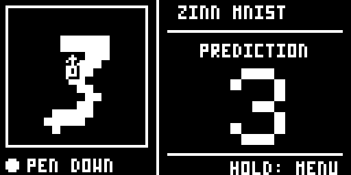

# ch32_mnist

**A rotary-drawn digit recognizer for a 16KB / 2KB CH32V003.**

[日本語](README_ja.md) · [Wiring](docs/wiring.md) · [Controls](docs/controls.md) · [Verification](docs/verification-report.md)

A standalone Zinn integration: a 16x16 binary canvas, 128x64 I2C OLED and one
push-button rotary encoder. Drawing, integer preprocessing, inference and display
all run locally. No PC/phone/cloud inference service, heap or floating-point NN.

**Status: host tests and CH32V003 cross-build verified; physical hardware not
verified.** The connected USB probe was Espressif, not a CH32 programmer. Display,
encoder responsiveness and handwritten recognition still need a real device.

## Build (no hardware needed)

Use Zig **0.17.0**. Place ch32_mnist next to the local zinn and ch32fun_zig packages
at the revisions in [architecture](docs/architecture.md). No mimoc-ui dependency
is needed: the HAL's actual 128-byte page-buffer API provides the OLED transport.

```sh
cd ~/ch32_mnist
zig version
zig build
zig build test
zig build test -Dtest-optimize=safe
zig build size
zig build simulate -- sample zig-out/sample.pbm
zig build simulate -- inspect zig-out/inspect.pbm
zig build simulate -- golden
zig build simulate > zig-out/preprocessing.csv
```

Default model: MLP32 packed int4, exported from the same frozen checkpoint as the
Zinn desktop demo. The complete int8 firmware exceeds Flash and is rejected;
`zig build test -Dmodel=mlp32-int8` still verifies its unchanged golden outputs.
Do not confuse the accuracy/size of older UART exports with this application.
[Model selection](docs/model-selection.md) and [provenance](models/PROVENANCE.md)
explain the tiny int4 calibration set and its limitations.

Artifacts: zig-out/firmware/ch32_mnist.elf, ch32_mnist.hex, firmware.bin;
zig-out/reports/ch32_mnist-memory.json. Final ELF checks include startup, statics,
reserved Flash, 512B main stack allowance and 128B ISR allowance. These allowances
are not measured stack usage. See [memory budget](docs/memory-budget.md).

```sh
zig build -Ddisplay=ssd1309
zig build -Ddisplay=ssd1315
zig build -Ddisplay=sh1106
zig build -Dmodel=mlp32-int4 -Dpreprocess=antialiased
zig build -Dtrace=true
zig build -Ddiagnostic=true -Dbenchmark=true -Dtrace=true --prefix zig-out/diagnostic
zig build assembly
ZIG=zig sh tools/verify.sh
```

SSD1306 is the default. The user confirmed correct display on the Movoid hardware configuration. Other controller paths are cross-build checked; device-wide inference timing and stack measurements remain unverified. -Dpreprocess selects direct/centered/normalized/antialiased;
normalized is the provisional default. The synthetic comparison is not a claim
about general handwriting recognition. MLP16 variants are not implemented.

## Operate and flash

DRAW: turn selects one of eight directions; click advances one cell. Hold 700ms
opens MENU: RESUME, PEN UP-DOWN, UNDO, PREDICT, CLEAR, SAMPLE, INSPECT.
Drawings classify after 600ms idle or explicit PREDICT. SAMPLE turns switch between
two reference images; PASS checks all logits. INSPECT shows relative score bars,
margin, selected output, device timing and optionally real hidden activations.
Logits are not probabilities. Full [controls](docs/controls.md).

**J4M6 pin 8 shares PD5 with PD1/SWIO. Disconnect Encoder B before programming.**
The normal build releases SWIO after a two-second grace period. Use the diagnostic
build with B isolated to retain debugger access; it disables the encoder and boots
SAMPLE. [Pin numbers, recovery and voltage](docs/wiring.md).

Only this explicit command writes hardware:

```sh
zig build flash
```

Requires minichlink or chzig; alternatively set MINICHLINK=/path/to/minichlink.
Build/test/size never flash. The diagnostic image built under a separate prefix
must be flashed with that same prefix/options; inspect tools/flash.sh before use.

## License

Original application code: [MIT](LICENSE). Zinn and ch32fun_zig retain their MIT
licenses; [third-party notices](THIRD_PARTY.md). No upstream source changes or
GitHub publication are part of this project. Benchmark results and unmeasured
items are explicitly separated in the verification report.

### OLED controller selection

SSD1306 (128×64) is the default, matching the Movoid wiring. The user confirmed correct display after replacing the previous hardware; failure of the previous panel remains a hypothesis. Other panels require the appropriate `-Ddisplay` option.

```sh
zig build
~/ch32fun/minichlink/minichlink -w zig-out/firmware/firmware.bin flash -b
```

The standard build installs ELF, HEX and BIN files under `zig-out/firmware/`. No custom output prefix is needed.

Rotary input follows Mopping_rotaly: GPIO polling with four valid phase edges per event. A 6ms polling window follows each OLED page transfer. Fast-rotation edge loss and the revised device response still require hardware confirmation.

## DRAW interface



The left canvas has an outlined cursor with an eight-direction arrow; the right
side shows a large prediction, pending dots or an empty marker. Hold and rotate
to move forward/backwards without turning. A held stroke is one UNDO operation.
See [controls](docs/controls.md) and [screenshots, budgets and limitations](docs/draw-ui.md).
No extra framebuffer or model change is introduced. Device validation of this
UI revision remains pending; the earlier SSD1306 display was user-confirmed.
