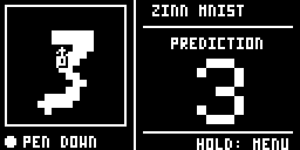

# ch32_mnist

**16KB Flash / 2KB SRAMのCH32V003で、ロータリー入力の数字を認識するデモ。**

[English](README.md) · [配線図](docs/wiring.svg) · [操作](docs/controls.md) · [検証記録](docs/verification-report.md)

Zinnを外部ライブラリとして使う独立プロジェクトです。16×16の1bpp Canvas、
128×64 I2C OLED、押し込み付きエンコーダーだけを使い、描画・整数前処理・推論・
表示をMCU内で完結させます。PC／スマートフォン／クラウドへの転送や、ヒープ、
浮動小数点ニューラルネットワークは使いません。

**ホストテスト・CH32V003クロスビルドを確認済み。実機は未検証です。**
接続中のUSB機器はEspressif製で、CH32用プログラマーは未検出でした。
OLED実表示、エンコーダーの応答、実際に描いた数字の認識は今後の確認事項です。

## ビルド

Zig **0.17.0**を使います。ch32_mnist、zinn、ch32fun_zigを同じ親ディレクトリに置き、
[調査したRevision](docs/architecture.md)に合わせてください。mimoc-uiのFull Runtimeは
採用せず、HALに実在する128B Page Buffer APIと小さな描画コードを使います。

```sh
cd ~/ch32_mnist
zig version
zig build
zig build test
zig build test -Dtest-optimize=safe
zig build size
zig build simulate -- sample zig-out/sample.pbm
zig build simulate -- inspect zig-out/inspect.pbm
zig build simulate -- golden
zig build simulate > zig-out/preprocessing.csv
```

標準モデルはMLP32 packed int4です。Desktop版と同じ凍結CheckpointからZinnのExporterで
生成しました。int8の統合FirmwareはFlash容量を超えるため、エラーとして拒否します。
`zig build test -Dmodel=mlp32-int8`で元の全Logitをホスト確認できます。
以前のUART版の精度・容量を今回のモデルやFirmwareへそのまま当てはめません。
[モデル選定](docs/model-selection.md)と[由来・生成方法](models/PROVENANCE.md)を参照してください。

生成物はzig-out/firmware/ch32_mnist.elf、ch32_mnist.hex、firmware.binです。
最終ELFのFlash／SRAM、予約Flash、通常Stack 512B＋ISR予算128Bを検査します。
予算は実測したスタック使用量ではありません。[メモリ設計](docs/memory-budget.md)。

```sh
zig build -Ddisplay=ssd1309
zig build -Ddisplay=ssd1315
zig build -Ddisplay=sh1106
zig build -Dmodel=mlp32-int4 -Dpreprocess=antialiased
zig build -Dtrace=true
zig build -Ddiagnostic=true -Dbenchmark=true -Dtrace=true --prefix zig-out/diagnostic
zig build assembly
ZIG=zig sh tools/verify.sh
```

標準OLEDはSSD1306です。Movoidと同じ構成で正常表示をユーザーが確認しています。他の制御経路はクロスビルド確認までで、推論時間・スタック使用量は未測定です。前処理はdirect／centered／normalized／antialiasedから選べます。
標準は暫定的にnormalizedです。合成図形の比較結果を一般的な手書き認識精度とは扱いません。
MLP16の選択肢は、MLP32 int4が収まったため追加していません。

## 操作と書き込み

DRAWでは回転で8方向を選び、短押しで1マス進みます。700ms長押しでMENUを開き、
RESUME、PEN UP-DOWN、UNDO、PREDICT、CLEAR、SAMPLE、INSPECTを選びます。
描画変更から600ms停止後、またはPREDICTで推論します。SAMPLEは既知入力2件を切り替え、
PASSは全Logitの参照一致を意味します。INSPECTでは相対Logitバー、Margin、選択出力、
実機推論時間、必要に応じて実際のHidden Activationを表示します。Logitは確率ではありません。

| 接続 | GPIO | J4M6端子番号 |
|---|---|---:|
| OLED SDA | PC1 | 5 |
| OLED SCL | PC2 | 6 |
| Encoder A | PA2 | 3 |
| Encoder B | PD5 | 8 |
| SW | PC4・内部プルアップ・Active Low | 7 |
| 3.3V / GND | VDD / VSS | 4 / 2 |

**端子8はPD5とPD1/SWIOの共用です。書き込み前にEncoder Bを切り離してください。**
通常版は起動2秒後にSWIOをGPIOへ切り替えます。診断版はSWIOを維持し、エンコーダーを
無効にしてSAMPLEで起動します。診断中もBを切り離してください。
[電圧・端子共用・復旧の注意](docs/wiring.md)に根拠を記録しました。

実機に書き込むのは次の明示操作だけです。

```sh
zig build flash
```

minichlinkまたはchzigが必要です。MINICHLINK=/path/to/minichlinkで直接指定もできます。
診断版を選ぶ場合は、そのBuild Optionを付けてflashしてください。
Build／test／sizeは物理デバイスへ書き込みません。

## ライセンス

本体の新規コードは[MIT](LICENSE)。依存ライブラリはそれぞれのMITライセンスに従います。
[第三者の権利・データ由来](THIRD_PARTY.md)。既存リポジトリの変更やGitHubへの公開は行いません。

### OLEDコントローラーの選択

既定はMovoidの配線に対応するSSD1306（128×64）です。ハードウェア交換後の正常表示をユーザーが確認しています。以前のパネルの故障は仮説として残します。他のパネルでは対応する`-Ddisplay`を指定してください。

```sh
zig build
~/ch32fun/minichlink/minichlink -w zig-out/firmware/firmware.bin flash -b
```

通常ビルドのELF・HEX・BINは`zig-out/firmware/`へ出力します。専用の出力先指定は不要です。

回転入力はMopping_rotalyと同じGPIOポーリング・2エッジ判定です。OLEDの各ページ転送後に6msの入力取得時間を設けています。高速回転時の取りこぼしと修正版の実機応答は確認待ちです。

## DRAW画面



左に枠付きキャンバスと8方向の矢印カーソル、右に大きな判定数字・推論待ち・未入力状態を表示します。
押しながら回転すると向きを変えず前進・後退し、1回の押下中の線を1回のUNDOで戻せます。
[操作説明](docs/controls_ja.md)と[画面・容量・制限](docs/draw-ui.md)を参照してください。
モデルとFramebuffer数は変更していません。従来SSD1306版の正常表示はユーザー確認済みですが、
今回のUI・押下回転操作の実機評価は未実施です。
