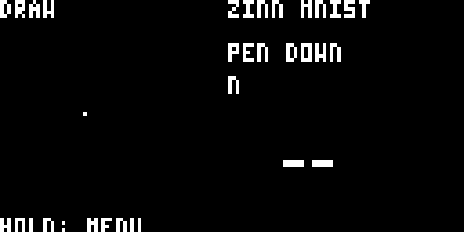
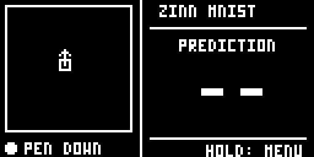
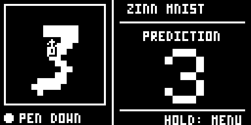
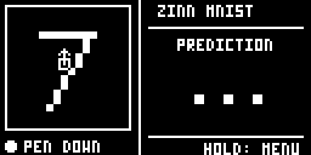
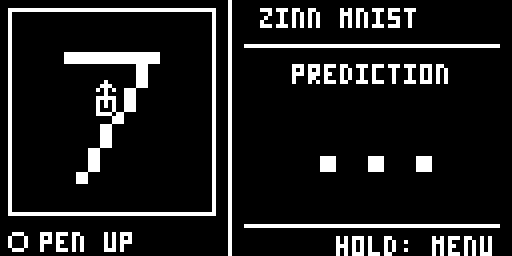
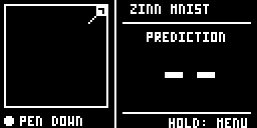
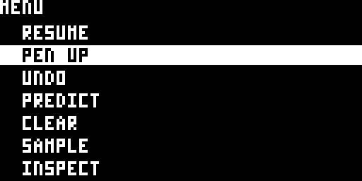
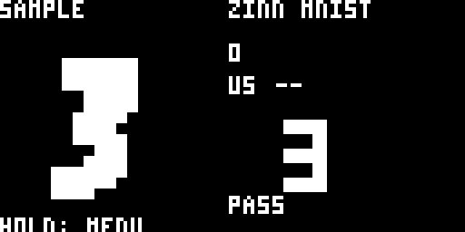
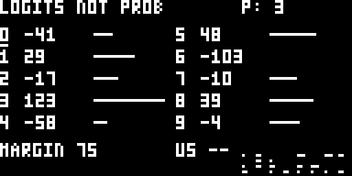

# DRAW UI revision

[English controls](controls.md) · [日本語の操作説明](controls_ja.md)

## Before / after

The following are host-rendered PBM snapshots, not photographs of device tests.

Before (empty):



After (empty):



After (actual integer inference of a thresholded bundled validation image):



The 16×16 bitmap is enlarged to 48×48 pixels at (4,4), with an outer frame.
The left cursor is a five-pixel square and a six-pixel arrow with a head. Their
pixels invert the underlying drawing, are clipped to the left canvas area, and
never enter the bitmap or inference input. The outward-edge arrow ends at the
cursor instead of extending into other UI. The right side has no direction
indicator. A dedicated 50-byte 5×7 digit table produces 20×28px predictions.
Empty, pending and complete are distinct. The filled/hollow PEN marker appears
only under the canvas. MENU inverts the selected row and names the next PEN action.

## Snapshot gallery

| State | Snapshot |
|---|---|
| PEN DOWN / pending |  |
| PEN UP / pending |  |
| PENDING |  |
| Cursor at outward edge |  |
| MENU |  |
| SAMPLE (retained) |  |
| INSPECT (retained) |  |

Regenerate PBMs without hardware:

```sh
zig build simulate -- draw-empty /tmp/draw-empty.pbm
zig build simulate -- draw-down /tmp/draw-down.pbm
zig build simulate -- draw-up /tmp/draw-up.pbm
zig build simulate -- draw-pending /tmp/draw-pending.pbm
zig build simulate -- draw-result /tmp/draw-result.pbm
zig build simulate -- draw-edge /tmp/draw-edge.pbm
zig build simulate -- menu /tmp/menu.pbm
zig build simulate -- sample /tmp/sample.pbm
zig build simulate -- inspect /tmp/inspect.pbm
```

`draw-result` thresholds bundled sample 0 to a binary drawing and runs the actual
preprocessing/model. Its displayed 3 is not a hardcoded prediction. It is not an
accuracy benchmark. SNAPSHOT images use nearest-neighbor scaling for readability.

## Verification and resources

Baseline: commit 17d757c, Zig 0.17.0, MLP32 int4, SSD1306, `.small`.

| Resource | Before | After | Difference |
|---|---:|---:|---:|
| Final ELF Flash | 14,208B | 16,060B | +1,852B |
| Static SRAM | 620B | 668B | +48B |
| Workspace | 32B | 32B | 0 |
| Main stack allowance | 512B | 512B | 0 |
| ISR allowance | 128B | 128B | 0 |

The 1KB Flash-growth goal was missed. The 64B reservation, 16KB Flash and 2KB
SRAM limits pass; default RAM margin is 740B after stack/ISR allowances.
Allowance is not measured stack usage. The largest observed single emitted frame is 224B in main; this is not a bound for the complete call chain. See [full option budgets](memory-budget.md).
Trace alone fits at 16,316B with 712B static SRAM. Full DRAW + Trace + benchmark
is rejected for Flash overflow; `-Ddiagnostic=true` is required when combining
Trace and benchmark. This restriction is explicitly covered by the verification
script and remains a compatibility limitation.

The model, packed weights, scales and preprocessing are unchanged. A one-cell
Turtle path now writes its two endpoints instead of running a general line loop;
all positions/directions are checked against the previous Bresenham path.

`tools/verify.sh` passed: int4/int8 × Debug/ReleaseSafe, 20 root test groups per
configuration; all generated golden logits and traced outputs match; all four
OLED controller cross-builds; diagnostic Trace/benchmark and antialiased builds;
byte-identical re-export; nine snapshot scenes; bad model/display options and
small Flash/RAM budgets rejected. No new runtime/library dependency is required.

UI tests cover all eight directions at central/edge/corner positions, blank and
filled canvases, no out-of-range pixels, full rendering versus eight page passes,
state immutability, distinct digit glyphs, pending/empty and inverted MENU.
Input tests cover clicks, long press, signed held movement, one-gesture UNDO,
release suppression, debounce boundaries, phase resets, order, overflow recovery,
wraparound, non-changing operations and the 100ms inference deadline.

## Timing and hardware status

```sh
zig build simulate -- benchmark
```

One macOS native `.safe` run (2,000 iterations, framebuffer clear plus one full
host draw): DRAW 1,555ns, SAMPLE 1,406ns, INSPECT 2,008ns per iteration. These are
host observations, not MCU latency or OLED transfer times. No baseline host timing
was collected, so no speedup claim is made. The CSV can vary across runs/machines.

Existing metrics retain render cycles (eight page renders) and transfer cycles,
excluding the polling windows. No device measurements were taken for this revision.
No physical flash was performed. The earlier SSD1306 display was user-confirmed;
the new cursor, held-rotation direction, press/release feel, maximum input speed,
queue loss, stack high-water, render and OLED transfer time still require device
validation. The four-record queue intentionally drops excess input rather than
replaying a malformed gesture. No claim of loss-free polling is made.

Normal build/write artifacts remain unchanged:

```sh
zig build
# Explicit physical write, only when ready to test:
~/ch32fun/minichlink/minichlink -w zig-out/firmware/firmware.bin flash -b
```

Disconnect the shared Encoder B / SWIO lead when programming as described in
[wiring](wiring.md). Neither model size nor OLED initialization was changed.
