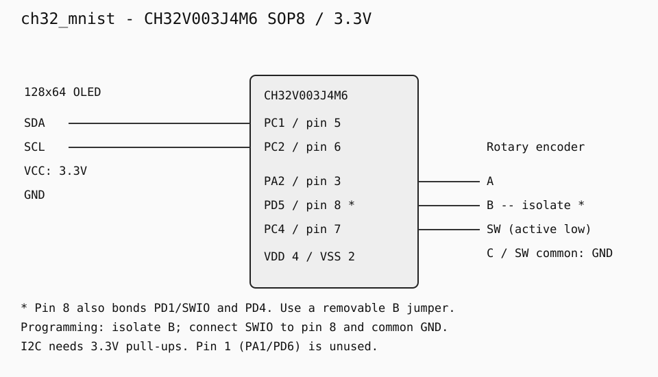

# Wiring and SWIO sharing

| Device | GPIO | SOP8 lead |
|---|---|---:|
| OLED SDA | PC1 | 5 |
| OLED SCL | PC2 | 6 |
| Encoder A | PA2 | 3 |
| Encoder B | PD5 | 8 |
| Button SW | PC4, internal pull-up, active low | 7 |
| VCC | 3.3V / VDD | 4 |
| GND | VSS; OLED/encoder C/button common | 2 |

Pin 1 (PA1/PD6) is unused. PA2 uses the internal HSI/PLL clock, not an external
oscillator. PC1/PC2 retain default I2C routing. Ensure SDA/SCL pull-ups are to
3.3V; check whether the OLED module already contains them.

**PD5, PD4 and PD1/SWIO bond to the same physical lead 8 on J4M6.** Encoder B
must be disconnected using a jumper while programming or debugging. A closed
encoder contact can ground SWIO. Normal firmware waits 2 seconds, then sets
AFIO.PCFR1 SWCFG[26:24]=100 to release SWIO; PD1/PD4 remain floating inputs and
PD5 becomes pull-up input. No pin sharing output is driven. If SWIO is disabled,
power-cycle/recover the target and program during the startup grace period using
your programmer's documented recovery procedure. Never assume concurrent SWIO
logging and Encoder B is supported.

The explicit diagnostic build preserves SWIO, disables encoder polling,
and starts with a known SAMPLE for debugger inspection. Keep Encoder B isolated
for the entire diagnostic session. The normal build boots DRAW.

Primary authored references (WCH documents mirrored without altering their content):
[Datasheet V1.3, CH32V003J4M6 pin diagram, printed page 11](https://akizukidenshi.com/goodsaffix/CH32V003.pdf),
[Reference Manual V1.9, AFIO_PCFR1 SWCFG and I2C routing, printed page 58](https://ch32-riscv-ug.github.io/CH32V003/datasheet_en/CH32V003RM.PDF),
[official WCH download page](https://www.wch-ic.com/downloads/CH32V003DS0_PDF.html).
The datasheet pin figure was inspected directly; package lead numbers are not
inferred from a TSSOP20 board. Electrical operation is not yet physically verified.
